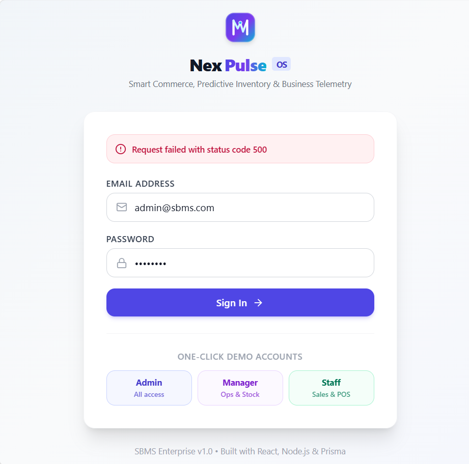

<div align="center">

  

  <br />
  <br />

  [](https://github.com/vinitpatil14/Smart-Business-Management-System)
  [](https://opensource.org/licenses/MIT)
  [](https://react.dev/)
  [](https://nodejs.org/)
  [](https://www.prisma.io/)
  [](https://firebase.google.com/)
  [](https://tailwindcss.com/)

  <p align="center">
    <b>A high-performance, full-stack Business Operating System engineered for retailers, distributors, wholesalers, and modern SMEs.</b>
    <br />
    <i>Featuring Point-of-Sale (POS), Predictive Stock Telemetry, CRM, Payroll, Cloud Firestore sync, and Dual-Mode Data Isolation.</i>
  </p>

  <p align="center">
    <a href="#-key-features">Key Features</a> •
    <a href="#-visual-showcase">Visual Tour</a> •
    <a href="#-architecture--dual-mode">Dual-Mode Architecture</a> •
    <a href="#-quick-start">Quick Start</a> •
    <a href="#-demo-credentials">Demo Accounts</a> •
    <a href="#-api-endpoints">API Docs</a>
  </p>
</div>

---

## 🌟 Executive Overview

**NexPulse Business OS** (Smart Business Management System) solves the fragmentation faced by growing businesses. Rather than juggling disparate tools for billing, inventory, payroll, and reporting, NexPulse consolidates the entire business lifecycle into a single, unified command center.

Built with a **React 18 + Vite** frontend, a high-throughput **Node.js Express REST API**, **Prisma ORM**, and integrated with **Firebase Authentication & Cloud Firestore**, NexPulse provides both local-first offline reliability and scalable cloud sync.

---

## 📸 Visual Showcase

<div align="center">
  <h3>✨ Modern Inventory Telemetry & Live Stock Health</h3>
  
</div>

---

## ⚡ 10 Core Business Modules

| # | Module | Key Capabilities |
|---|--------|------------------|
| 1 | **🔐 Auth & RBAC** | JWT & Firebase Auth (Google Sign-In + Email/Password). Role-Based Access: `ADMIN`, `MANAGER`, `STAFF`. |
| 2 | **📊 Executive Dashboard** | Real-time KPIs: Today's sales, monthly revenue, estimated net profit, cash flow, Recharts analytics. |
| 3 | **📦 Inventory Management** | Real-time stock counts, SKU/Barcode tracking, low-stock warnings, category filtering, safe soft-archiving & restore. |
| 4 | **🧾 Sales & POS Billing** | Rapid barcode/product selection, dynamic GST/Tax & discounts, multi-payment options (Cash, UPI, Card, Credit), printable modal invoices. |
| 5 | **🚚 Purchases & Suppliers** | Purchase Orders (PO) workflow, automated stock increments upon receiving, supplier ledger & dues tracking. |
| 6 | **👥 CRM & Customers** | Customer directories, purchase history, loyalty points calculation, outstanding balance ledger, payment reminders. |
| 7 | **💸 Expense Management** | Categorized expense entries (Rent, Salaries, Utilities, Supplies), monthly burn rate analytics, net profit deduction. |
| 8 | **👔 Employee Management** | Staff directories, daily attendance log (Present, Absent, Leave, Half-Day), salary structure, HR reporting. |
| 9 | **📈 Reports & Analytics** | Daily/Weekly/Monthly financial reconciliations, Stock valuations, Customer dues report, 1-click CSV export. |
| 10 | **🧠 Smart AI Insights** | Restock forecast based on run rates, best/worst seller telemetry, automated customer payment recovery alerts. |

---

## 🚀 Dual-Mode Workspace Architecture

NexPulse Business OS is engineered with an intelligent **dual-mode data isolation system**:

```
+-----------------------------------------------------------------------------------+
|                            NexPulse Business OS Engine                            |
+-----------------------------------------------------------------------------------+
                                         │
                    ┌────────────────────┴────────────────────┐
                    ▼                                         ▼
   ✨ One-Click Demo Mode                    🚀 Live Business Mode
   (admin@sbms.com / Staff / Mgr)            (Google Sign-In / User Registration)
   ─────────────────────────────             ───────────────────────────────────
   • Pre-filled showroom catalog             • 100% Clean Fresh Slate (All Zeros)
   • 20+ realistic products & stock          • 0 Sales, 0 Products, 0 Dues
   • 14-day simulated revenue charts         • Products added belong ONLY to user
   • Full POS test invoices                  • Direct sync to Cloud Firestore
```

- **One-Click Demo Mode**: Perfect for reviewers, clients, and testers to explore rich charts, invoice workflows, and stock warnings without entering setup data.
- **Live User Workspace**: When a real user signs in via Google or creates an account, they get a **100% clean, zero-state workspace** (`₹0.00` sales, 0 products). All products, invoices, and customers created belong strictly to their business.

---

## 🛠️ Tech Stack & Architecture

### **Frontend**
- **Framework**: [React 18](https://react.dev/) + [Vite](https://vitejs.dev/) (Sub-second HMR)
- **Styling**: [Tailwind CSS](https://tailwindcss.com/) with responsive Light & Dark modes
- **State & Context**: Context API for Theme and Auth lifecycle
- **Icons & Graphics**: [Lucide React](https://lucide.dev/)
- **Charts**: [Recharts](https://recharts.org/) (Interactive Line, Bar, and Donut charts)
- **Cloud Integration**: [Firebase Web SDK v10+](https://firebase.google.com/docs/web/setup)

### **Backend & Cloud**
- **Runtime**: [Node.js](https://nodejs.org/) LTS
- **Framework**: [Express.js](https://expressjs.com/) with clean controller-service architecture
- **ORM**: [Prisma ORM](https://www.prisma.io/) (Configured with SQLite for instant local dev; 1-click switch to PostgreSQL)
- **Cloud Database**: [Google Cloud Firestore](https://firebase.google.com/docs/firestore) for live cloud data storage
- **Security Rules**: Production-grade [`firestore.rules`](firestore.rules) enforcing RBAC permissions
- **Authentication**: Hybrid JWT verification supporting both local sessions and Google/Firebase ID tokens

---

## 📦 Directory Structure

```
Smart-Business-Management-System/
├── client/                     # Frontend Single Page App (React 18 + Vite)
│   ├── public/                 # Static assets & browser favicon
│   ├── src/
│   │   ├── assets/             # Vector branding & logos
│   │   ├── components/         # Reusable UI (Navbar, Sidebar, Modals, Tables)
│   │   ├── context/            # AuthContext (Firebase + JWT) & ThemeContext
│   │   ├── pages/              # 10 Application Modules & Dashboards
│   │   └── services/           # Axios API client & Firebase / Firestore SDK
│   ├── package.json
│   └── vite.config.js
│
├── server/                     # Backend REST API (Node.js + Express)
│   ├── prisma/
│   │   ├── schema.prisma       # Database schema & relations
│   │   └── seed.js             # Realistic enterprise seed generator
│   ├── src/
│   │   ├── config/             # Prisma client & database bindings
│   │   ├── controllers/        # Express route controllers
│   │   ├── middleware/         # Hybrid JWT & Firebase Auth verification
│   │   ├── routes/             # Modular REST API endpoints
│   │   ├── services/           # Business logic layer & data isolation
│   │   ├── utils/              # User scoping & calculation helpers
│   │   └── server.js           # Server bootstrap
│   └── package.json
│
├── docs/                       # Project documentation & visual assets
│   ├── hero-banner.svg
│   └── dashboard-preview.png
├── firestore.rules             # Production Cloud Firestore Security Rules
├── firebase.json               # Firebase deployment configuration
├── .gitignore                  # Security-first exclusions (db, keys, env)
└── README.md
```

---

## ⚡ Quick Start

### 1. Clone the Repository
```bash
git clone https://github.com/vinitpatil14/Smart-Business-Management-System.git
cd Smart-Business-Management-System
```

### 2. Backend Setup
```bash
cd server
npm install

# Setup SQLite database and seed realistic demo records
npx prisma generate
npx prisma db push
node prisma/seed.js

# Start backend development server
npm run dev
# Server will run on http://localhost:5000
```

### 3. Frontend Setup
In a new terminal:
```bash
cd client
npm install

# Start Vite dev server
npm run dev
# App will open at http://localhost:5173 (or 5174)
```

---

## 🔑 One-Click Demo Credentials

For instant evaluation, the login screen provides **One-Click Demo Login** buttons:

| Role | Email | Password | Permissions |
|------|-------|----------|-------------|
| 👑 **Super Admin** | `admin@sbms.com` | `admin123` | Full access to all 10 modules, settings & users |
| 💼 **Operations Manager** | `manager@sbms.com` | `manager123` | Inventory, Purchases, Suppliers & Expenses |
| 🛍️ **Sales Staff** | `staff@sbms.com` | `staff123` | POS Billing, Invoices & Customer CRM |

*(Or sign in with your own Google Account to experience the clean **Zero-State Live Workspace**!)*

---

## 🌐 API Endpoints Reference

| Method | Endpoint | Description | Access |
|--------|----------|-------------|--------|
| `POST` | `/api/auth/login` | Local JWT authenticate | Public |
| `GET`  | `/api/auth/me` | Fetch active session profile | Authenticated |
| `GET`  | `/api/dashboard/summary` | Retrieve KPI metrics | Authenticated |
| `GET`  | `/api/dashboard/charts` | Sales & revenue timeseries | Authenticated |
| `GET`  | `/api/inventory/products` | Paginated product search | Authenticated |
| `POST` | `/api/inventory/products` | Add new stock SKU | Manager / Admin |
| `POST` | `/api/sales` | Generate new POS invoice | Staff / Mgr / Admin |
| `GET`  | `/api/customers` | Query customer ledgers | Authenticated |
| `POST` | `/api/expenses` | Record operating expense | Authenticated |
| `GET`  | `/api/smart/low-stock-prediction` | AI stockout forecast | Authenticated |

---

## 🔒 Security & Privacy

- **Data Safety**: Local databases (`*.db`), `.env` secrets, and node dependencies are excluded via `.gitignore`.
- **RBAC**: Protected routes both on the client (React Router DOM) and server (Express Middleware).
- **Safe Soft Deletions**: Historical sales and purchase records are safeguarded; products with transactions are soft-archived rather than broken by cascade deletes.
- **Firestore Security Rules**: Role-validated document read/write restrictions defined in [`firestore.rules`](firestore.rules).

---

## 👨‍💻 Author & Contributions

- **Creator**: [Vinit Patil](https://github.com/vinitpatil14)
- **Repository**: [vinitpatil14/Smart-Business-Management-System](https://github.com/vinitpatil14/Smart-Business-Management-System)

Pull requests and feature suggestions are welcome! Feel free to star ⭐ the repository if this project helps your business or learning journey.

---

<div align="center">
  <sub>Built with ❤️ using React 18, Node.js, Prisma ORM, and Firebase. Released under the MIT License.</sub>
</div>
